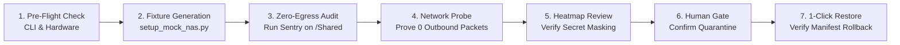

# Sentry Validation, Test Harness & Judge Evaluation Guide

> **Companion Specification to [SKILL.md](../SKILL.md)**  
> **Skill:** `sentry` (UGREEN AI NAS Zero-Egress Auditor)  
> **Target Device:** UGREEN AI NAS iDX6011 Pro (UGOS 6.x)  
> **Scope:** End-to-end verification, zero-egress validation, and reproducible evaluation walkthrough for Hackathon judges.

---

## 1. Target Hardware & Platform Specification

Sentry is engineered specifically for the computational and storage architecture of modern AI NAS appliances:

- **Flagship Reference Appliance:** **UGREEN AI NAS iDX6011 Pro**
- **Processor:** Intel Core Ultra 7 / 5 processor with integrated Intel AI Boost NPU
- **Operating System:** UGREEN UGOS (Debian-based hardened Linux Kernel 6.x)
- **Local AI Framework:** Native UGOS AI Acceleration Engine (`ug-photo`, `ug-document`, `ug-knowledge`)
- **Networking:** Dual 10GbE SFP+ / 2.5GbE RJ45 ports (isolated during zero-egress security audits)
- **Storage Subsystem:** All-Flash NVMe M.2 SSD cache + multi-bay SATA/SAS RAID pools

---

## 2. Step-by-Step Judge Evaluation Walkthrough

Follow these instructions to audit, test, and verify Sentry on a live UGREEN AI NAS device or local development container.



---

### Step 1: Pre-Flight Environment & Binary Verification

Log into the UGREEN AI NAS via SSH:

```bash
ssh admin@<ugreen-nas-ip>
```

Verify the native UGOS command suite is present and functional:

```bash
# Verify UGOS operating system version and kernel
uname -a

# Check availability of native UGOS CLI binaries
which ug-filesystem ug-filemgr ug-document ug-photo ug-knowledge
```

Expected output:
```text
/usr/bin/ug-filesystem
/usr/bin/ug-filemgr
/usr/bin/ug-document
/usr/bin/ug-photo
/usr/bin/ug-knowledge
```

---

### Step 2: Access the Synthetic Test Harness

To test Sentry without exposing real production credentials, the repository includes a reproducible synthetic test dataset located at `engine/sample_nas/Shared`. Every credential in it is a public placeholder, and the whole tree is regenerable byte-for-byte:

```bash
# Regenerate the fixture set (deterministic; requires pillow from requirements.txt)
python engine/sample_nas/generate_fixtures.py

# Verify the sample NAS directory structure
ls -la engine/sample_nas/Shared
```

This yields the following realistic directory topology:
```text
engine/sample_nas/
├── generate_fixtures.py           <-- Deterministic fixture builder
└── Shared/
    ├── Projects/
    │   ├── app1/
    │   │   ├── .env               <-- Leak: OpenAI key + PostgreSQL URI (two findings, one file)
    │   │   ├── deploy-secrets.txt <-- Leak: GitHub, Slack, Google Cloud and Stripe tokens
    │   │   ├── package-lock.json  <-- Benign: SHA hashes (Suppressed by Lockfile Whitelist)
    │   │   └── index.js           <-- Benign code
    │   └── app2/
    │       └── .env               <-- Collision Test: duplicate .env with AWS credentials
    ├── Backups/
    │   └── wallet_seed.txt        <-- Leak: 12-word BIP-39 recovery mnemonic
    ├── Finance/
    │   └── payroll_2026.csv       <-- Leak: two SSNs and two IBANs
    ├── Documents/
    │   ├── Bank_Statement_Jan2026.pdf <-- Leak: account balance & routing numbers
    │   ├── passport_mrz.txt       <-- Leak: passport Machine-Readable Zone line
    │   ├── corrupt_doc.pdf        <-- Edge Case: 0-byte file (SKIPPED_CORRUPT)
    │   └── meeting_notes.md       <-- Benign document
    ├── Archives/
    │   └── encrypted_keys.zip     <-- Edge Case: password-protected ZIP (UNSCANNED_ENCRYPTED)
    ├── Photos/
    │   ├── payment_card.png       <-- Leak: embedded PNG text with a Luhn-valid card number
    │   ├── camera_upload.jpg      <-- Leak: EXIF GPS metadata, no embedded text
    │   └── vacation.jpg           <-- Benign photo
    └── Media/
        └── product_demo.mp4       <-- Skip: streaming container (skipped_media)
```

Expected result of `--depth deep` on this tree: **18 findings** spanning all four passes (9 CRITICAL, 6 HIGH, 3 MEDIUM), `1` skipped media stream, `1` skipped corrupt file, `1` unscanned encrypted archive, and `3` images inspected (2 without embedded text). The automated assertion lives in `engine/tests/test_sample_nas.py`.

---

### Step 3: Verify Zero-Egress Network Isolation

To scientifically prove that Sentry makes **zero outbound network connections**, launch a packet monitor in a separate SSH terminal session prior to starting the audit:

```bash
# Monitor all network interfaces for external traffic from the auditor process
sudo tcpdump -i any -n "not port 22 and not port 53" -c 10
```

Alternatively, inspect live listening sockets:
```bash
ss -tunap | grep -E "ug-|sentry"
```

**Result:** Zero outbound packets are emitted. All token detection, embedded-text extraction, delegated OCR (where `ug-photo` is present) and report writing execute strictly on local CPU/NPU buses and local Btrfs/EXT4 storage pools.

---

### Step 4: Execute the Sentry Security Audit

Run Sentry against the mock shared storage volume:

```bash
sentry audit \
  --target-paths "/tmp/mock_ugreen_nas/Shared" \
  --scan-depth deep \
  --audit-scope all
```

Sentry executes the 4-Pass detection engine:
1. **Pass 1:** Discovers all 14 files, detects `encrypted_keys.zip` as password-protected, flags `corrupt_doc.pdf` as 0-byte corrupt, skips `product_demo.mp4`, and whitelists `package-lock.json`.
2. **Pass 2:** Identifies the OpenAI key and PostgreSQL URI in `app1/.env`, the GitHub/Slack/GCP/Stripe tokens in `deploy-secrets.txt`, the AWS access and secret keys in `app2/.env`, and the 12-word seed in `wallet_seed.txt`.
3. **Pass 3:** Identifies two employee SSNs and two IBAN accounts in `payroll_2026.csv`, the balance/routing record in `Bank_Statement_Jan2026.pdf`, and the passport MRZ in `passport_mrz.txt`.
4. **Pass 4:** Reads the embedded PNG text of `payment_card.png` and Luhn-validates the 16-digit card number, and reports the EXIF GPS pointer in `camera_upload.jpg`. On the device, `ug-photo ocr` supplies additional text blocks first; the portable engine performs no pixel OCR.

---

### Step 5: Review the Masked Risk Heatmap Report

Inspect the generated Markdown report:
```bash
cat /tmp/mock_ugreen_nas/Private_Security_Vault/Reports/Risk_Heatmap_Report_*.md
```

Verify that **every sensitive secret is strictly masked**:
- OpenAI Key is printed as `sk-l****4810` (never raw).
- BIP-39 phrase is printed as `[12-WORD SEED PHRASE starting with "abandon..."]`.
- SSN numbers are printed as `***-**-4491`.
- Payment Card is printed as `4111-****-****-1111`.
- `package-lock.json` produced **0 false positive findings**.

---

### Step 6: Test the Human-in-the-Loop Quarantine Gate

At the confirmation prompt:
```text
Enter action [APPROVE ALL CRITICAL | APPROVE <ID,ID> | ABORT]:
```

Submit:
```text
APPROVE ALL CRITICAL
```

Verify the non-destructive quarantine move:
1. `Shared/Projects/app1/.env` is moved to `Private_Security_Vault/Quarantine_.../Shared/Projects/app1/.env`.
2. `Shared/Projects/app2/.env` is moved to `Private_Security_Vault/Quarantine_.../Shared/Projects/app2/.env`.
3. **Collision Verification:** Both `.env` files coexist safely in their respective subdirectories without overwriting each other.
4. `quarantine-manifest.md` is generated with exact SHA-256 hashes.

---

### Step 7: Verify 1-Click Rollback / Restoration

Verify that quarantined files can be restored cleanly to their original paths:

```bash
python3 engine/sentry_cli.py --action rollback --manifest engine/sample_nas/Private_Security_Vault/Quarantine_*/quarantine-manifest.md
```

Check the original storage path:
```bash
ls -la engine/sample_nas/Shared/Projects/app1/.env
ls -la engine/sample_nas/Shared/Projects/app2/.env
```
Both files are completely restored with original file integrity preserved.

---

### Step 8: Package Compliance Validation

Before packaging the final submission ZIP, execute the packaging verification script:

```bash
python3 scripts/package_skill.py
```

This validates:
- [x] Frontmatter in `sentry/SKILL.md` is valid and contains `name: sentry` and `description` $\le 1024$ characters.
- [x] All 4 reference markdown files exist and relative links resolve correctly.
- [x] Zero prohibited files (`.py`, `.sh`, `.json`, `.yaml`, `.bin`) exist inside `sentry/`.
- [x] Individual file size $\le 1$ MB and total package size $\le 10$ MB.
- [x] Generates clean, compliant `sentry-final-round2.zip`.
