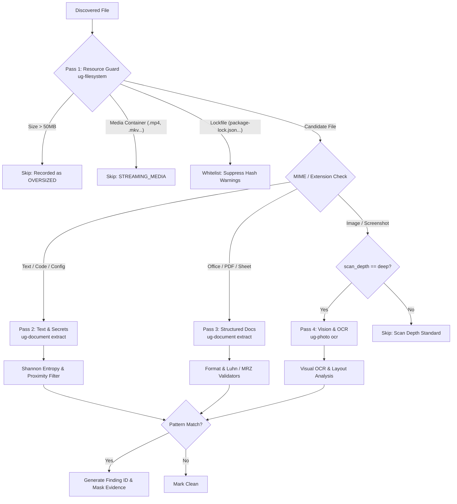

# Sentry Detection Taxonomy & Pattern Reference

> **Companion Specification to [SKILL.md](../SKILL.md)**  
> **Skill:** `sentry` (UGREEN AI NAS Zero-Egress Auditor)  
> **Scope:** Comprehensive pattern catalog, regular expressions, algorithmic validators, and suppression rules.

---

## 1. Detection Engine Architecture

The Sentry detection engine operates as a four-pass deterministic state machine designed to minimize disk I/O and processor load on the UGREEN AI NAS while maintaining high recall and precision across heterogenous file collections.



---

## 2. Pass 1 — Inventory & Resource Guard

### File Categorization Matrix

| Category | File Extensions | Action | Justification |
| :--- | :--- | :--- | :--- |
| **Configuration & Code** | `.env*`, `.pem`, `.key`, `.p12`, `.json`, `.yaml`, `.yml`, `.txt`, `.md`, `.csv`, `.log`, `.sql`, `.xml`, `.conf`, `.ini` | **Inspect in Pass 2** | Primary source of developer credentials, API tokens, and connection strings. |
| **Structured Documents** | `.pdf`, `.docx`, `.xlsx`, `.csv`, `.odt`, `.ods`, `.rtf` | **Inspect in Pass 3** | Common carrier of tax forms, bank statements, identity cards, and payroll exports. |
| **Visual Media** | `.png`, `.jpg`, `.jpeg`, `.webp`, `.heic`, `.tiff`, `.bmp` | **Inspect in Pass 4 (Deep)** | Common destination for camera uploads, scanned identity documents, payment card photos, and crypto seed screenshots. |
| **Binary Executables** | `.exe`, `.dll`, `.so`, `.bin`, `.app`, `.dmg`, `.deb`, `.rpm` | **Skip** | Executable binaries lack structured secret context and risk triggering high false positives. |
| **Media Streams** | `.mp4`, `.mkv`, `.avi`, `.mov`, `.wmv`, `.flv`, `.webm`, `.mp3`, `.wav`, `.flac`, `.aac`, `.ogg`, `.m4a` | **Skip** | High volume, low probability of extractable text secrets; protects NAS disk pool I/O. |
| **Disk Images** | `.iso`, `.img`, `.vmdk`, `.qcow2`, `.vdi` | **Skip** | Monolithic container images exceed single-file processing budgets. |
| **Dependency Locks** | `package-lock.json`, `yarn.lock`, `pnpm-lock.yaml`, `Cargo.lock`, `poetry.lock`, `composer.lock`, `Gemfile.lock` | **Whitelist / Suppress** | Contain hundreds of SHA-256/512 checksums that naive scanners mistake for active tokens. |

### Resource Safeguard Invariants
- **Maximum File Size Ceiling:** Exactly **52,428,800 bytes (50 MB)**. Files exceeding this threshold are bypassed and recorded in the audit log under `SKIPPED_OVERSIZED`.
- **Symlink Depth Limit:** Recursion stops at a directory depth of **16 levels** to avoid symlink loop traps across nested user folders.

---

## 3. Pass 2 — Text, Code & Configuration Secrets

### Secret Token Signatures & Regular Expressions

```text
 ┌────────────────────────────────────────────────────────────────────────┐
 │                   PASS 2: CREDENTIAL PATTERN MATRIX                    │
 ├────────────────────────┬───────────────────────────────────────────────┤
 │ Secret Type            │ Canonical Regular Expression                  │
 ├────────────────────────┼───────────────────────────────────────────────┤
 │ OpenAI API Key         │ sk-(?:proj-|live-)?[a-zA-Z0-9_-]{32,64}       │
 │ AWS Access Key ID      │ (?:A3T[A-Z0-9]|AKIA|AGPA|AIDA|AROA|AIPA|ANPA │
 │                        │ |ANVA|ASIA)[A-Z0-9]{16}                       │
 │ AWS Secret Access Key  │ (?i)aws_secret_access_key\s*=\s*[a-zA-Z0-9/+= │
 │                        │ ]{40}                                         │
 │ GitHub Token (Classic) │ ghp_[a-zA-Z0-9]{36}                           │
 │ GitHub Fine-Grained    │ github_pat_[a-zA-Z0-9]{22}_[a-zA-Z0-9]{59}    │
 │ Slack Bot / User Token │ xox[baprs]-[0-9]{10,13}-[a-zA-Z0-9]{24,32}   │
 │ Google Cloud API Key   │ AIza[0-9A-Za-z\-_]{35}                        │
 │ Square Access Token    │ sq0csp-[0-9A-Za-z\-_]{43}                     │
 │ Stripe Secret Key      │ (?:sk|rk)_(?:live|test)_[a-zA-Z0-9]{24,99}    │
 │ Private Key Banners    │ -----BEGIN (?:RSA |EC |OPENSSH |DSA )?PRIVATE │
 │                        │ KEY-----                                      │
 │ Database Connection    │ (?:postgres|postgresql|mongodb\+srv|mongodb   │
 │ Strings with Passwords │ |mysql):\/\/[^:\s]+:[^@\s]+@[^\/\s]+          │
 └────────────────────────┴───────────────────────────────────────────────┘
```

### BIP-39 Cryptocurrency Recovery Seed Phrases

BIP-39 mnemonic recovery phrases represent root access to cryptocurrency wallets. Sentry validates candidate word sequences against the official 2,048-word BIP-39 English dictionary:

- **Detection Rule:**
  - 12 or 24 consecutive lowercase words separated by single spaces or newlines.
  - Every candidate word must belong to the BIP-39 dictionary (e.g., `abandon`, `ability`, `able`, `about`, `above`, `absent`, `absorb`, `abstract`, `absurd`, `abuse`, `access`, `accident`...).
  - Proximity check: Look for adjacent keywords such as `seed`, `mnemonic`, `recovery`, `bip39`, `ledger`, `trezor`, `metamask`, `wallet`.
- **Severity Rating:** `CRITICAL` ($S = 5.0$).

---

## 4. Pass 3 — Structured Documents & Financial Records

Pass 3 processes `.pdf`, `.docx`, `.xlsx`, and `.csv` files using `ug-document` to uncover personal identity and banking records.

### Banking & Financial Regex Rules

#### 1. International Bank Account Numbers (IBAN)
- **Regex:** `\b[A-Z]{2}[0-9]{2}[A-Z0-9]{4}[0-9]{7}([A-Z0-9]?){0,16}\b`
- **Validation:** Modulo-97 check ($ISO\ 7064$). Convert letters to numbers ($A=10 \dots Z=35$), move the first 4 characters to the end, and verify that the integer modulo 97 equals 1.
- **Severity:** `HIGH` ($S = 3.0$) if accompanied by account holder names or balances; otherwise `MEDIUM` ($S = 1.0$).

#### 2. SWIFT / BIC Codes
- **Regex:** `\b[A-Z]{6}[A-Z0-9]{2}([A-Z0-9]{3})?\b`
- **Context Guard:** Only triggers when within 10 lines of `SWIFT`, `BIC`, `Bank`, or `Wire Transfer`.

#### 3. Payroll & Tax Ledgers
- Detects recurring tables containing `Gross Pay`, `Net Pay`, `Withholding`, `Federal Tax`, `Medicare`, or `Social Security`.
- **Severity:** `HIGH` ($S = 3.0$).

### Government Identification Patterns

#### 1. United States Social Security Number (SSN)
- **Regex:** `\b(?!000|666|9\d{2})\d{3}-(?!00)\d{2}-(?!0000)\d{4}\b`
- **Exclusion Filters:** Suppresses advertising numbers, sequential digits (`123-45-6789`), and all zeroes.
- **Severity:** `HIGH` ($S = 3.0$).

#### 2. Passport Machine Readable Zone (MRZ - ICAO Doc 9303)
- **Type 3 (Passports, 2 lines of 44 characters):**
  - Line 1: `P<[A-Z]{3}[A-Z0-9<]{39}`
  - Line 2: `[A-Z0-9<]{9}[0-9]{1}[A-Z]{3}[0-9]{6}[0-9]{1}[MF<][0-9]{6}[0-9]{1}[A-Z0-9<]{14}[0-9]{1}[0-9]{1}`
- **Severity:** `HIGH` ($S = 3.0$).

#### 3. UK National Insurance Number (NINO)
- **Regex:** `\b[A-CEGHJ-PR-TW-Z]{1}[A-CEGHJ-NPR-TW-Z]{1}[0-9]{6}[A-DFM]{0,1}\b`
- **Severity:** `HIGH` ($S = 3.0$).

---

## 5. Pass 4 — Visual OCR & Screenshot Audit (`ug-photo`)

When `scan_depth=deep`, Sentry engages the UGREEN AI NAS NPU via `ug-photo` to inspect image files.

### Payment Card Verification (Luhn Algorithm)

Sentry parses text strings extracted from card photos:

```python
def luhn_checksum_valid(number_str: str) -> bool:
    """Verifies candidate card number against ISO/IEC 7812 Luhn checksum."""
    clean_digits = [int(c) for c in number_str if c.isdigit()]
    if not (13 <= len(clean_digits) <= 19):
        return False
    checksum = 0
    reverse_digits = clean_digits[::-1]
    for idx, digit in enumerate(reverse_digits):
        if idx % 2 == 1:
            doubled = digit * 2
            checksum += (doubled - 9) if doubled > 9 else doubled
        else:
            checksum += digit
    return checksum % 10 == 0
```

- **Major Card Brand Prefixes:**
  - Visa: `^4[0-9]{12}(?:[0-9]{3})?$`
  - Mastercard: `^(?:5[1-5][0-9]{2}|222[1-9]|22[3-9][0-9]|2[3-6][0-9]{2}|27[01][0-9]|2720)[0-9]{12}$`
  - American Express: `^3[47][0-9]{13}$`
  - Discover: `^6(?:011|5[0-9]{2})[0-9]{12}$`
- **Expiration Date Correlation:** Matches `(?:0[1-9]|1[0-2])\/?([0-9]{2}|[0-9]{4})`.
- **Severity:** If valid Luhn number + expiration date are found together, score as `HIGH` ($S = 3.0$). If CVV/CVC is also visible, upgrade to `CRITICAL` ($S = 5.0$).

### Visual Identity Document Recognition
`ug-photo analyze --type id_card,document` checks visual aspect ratios and returns layout tags:
- `layout: passport_spread`
- `layout: drivers_license_front`
- `layout: credit_card_front`

If visual layout detection matches with confidence $\ge 0.75$, findings are classified as `HIGH` ($S = 3.0$).

---

## 6. Shannon Entropy & False Positive Suppression

To avoid alerting on random hashes or GUIDs, Sentry applies Shannon Entropy analysis to candidate secret strings:

$$H(X) = -\sum_{i=1}^{n} P(x_i) \log_2 P(x_i)$$

Where:
- $n$ is the number of distinct characters in the candidate string.
- $P(x_i)$ is the empirical probability of character $x_i$ appearing in the string.

### Entropy Decision Boundaries
- **Natural Language Prose:** $3.0 \le H < 4.2$ bits/character $\rightarrow$ **Suppress** (False Positive).
- **Standard UUIDs & Monotonic Sequences:** $H < 3.8$ bits/character $\rightarrow$ **Suppress**.
- **Cryptographic Keys & High-Entropy Tokens:** $H \ge 4.5$ bits/character $\rightarrow$ **Trigger Deep Regex Inspection**.

### Lockfile Suppression Mechanics
Package lockfiles contain valid Base64 and Hexadecimal integrity hashes (e.g., `sha512-...`). Sentry suppresses integrity checks if the file matches the whitelist pattern:
`/(package-lock\.json|yarn\.lock|pnpm-lock\.yaml|Cargo\.lock|poetry\.lock|composer\.lock)$/`

This suppression ensures zero false positives during routine developer workspace audits.
