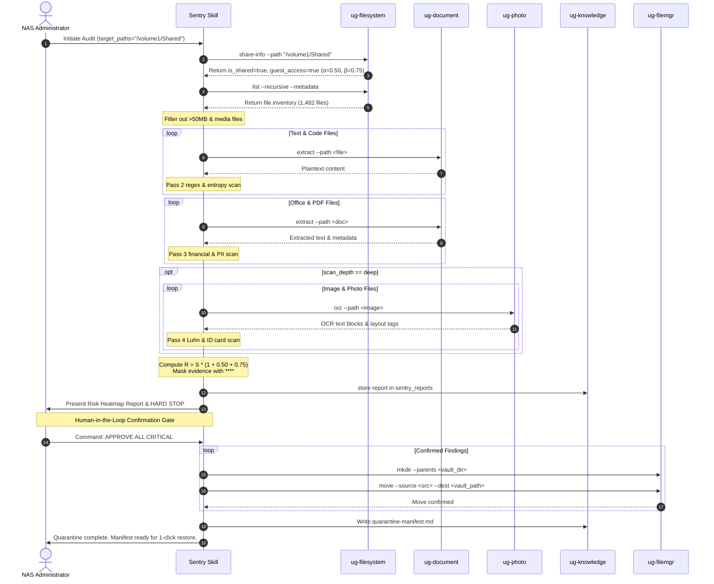

# Sentry UGOS Native CLI Orchestration & Quarantine Protocol

> **Companion Specification to [SKILL.md](../SKILL.md)**  
> **Skill:** `sentry` (UGREEN AI NAS Zero-Egress Auditor)  
> **Scope:** Exact UGOS CLI command schemas, JSON outputs, orchestration flow, and reversible quarantine procedures.

---

## 1. Native UGOS Command Catalog

Sentry executes 100% locally on UGOS by orchestrating five native operating system binaries. No external runtimes, third-party packages, or cloud APIs are required.

```text
 ┌────────────────────────────────────────────────────────────────────────┐
 │                      UGOS NATIVE COMMAND SUITE                         │
 ├────────────────┬───────────────────────────────────────────────────────┤
 │ Binary         │ Functional Domain in Sentry                           │
 ├────────────────┼───────────────────────────────────────────────────────┤
 │ ug-filesystem  │ Storage enumeration, metadata, POSIX permissions,     │
 │                │ and network share (SMB/NFS/WebDAV) context auditing.  │
 │ ug-document    │ Native text extraction and metadata inspection for    │
 │                │ code, configuration, PDF, DOCX, XLSX, and CSV files.  │
 │ ug-photo       │ On-device NPU-accelerated OCR and visual layout       │
 │                │ classification for image files (passports, cards).    │
 │ ug-knowledge   │ Local knowledge-base indexing and persistent storage  │
 │                │ for Risk Heatmap Reports and historical audits.       │
 │ ug-filemgr     │ Atomic directory creation, safe file isolation,       │
 │                │ relative path mirroring, and 1-click restoration.     │
 └────────────────┴───────────────────────────────────────────────────────┘
```

---

## 2. Command Specifications & Response Schemas

### 2.1. `ug-filesystem`

#### Command: Query Share Context & Exposure
```bash
ug-filesystem share-info --path "/volume1/Shared" --format json
```
**JSON Response Schema:**
```json
{
  "status": "success",
  "data": {
    "mount_point": "/volume1/Shared",
    "filesystem_type": "btrfs",
    "is_shared": true,
    "share_protocols": ["smb", "nfs", "webdav"],
    "guest_access_allowed": true,
    "multi_user_write": true,
    "access_control_list": {
      "owner": "admin",
      "group": "users",
      "mode": "0777"
    }
  }
}
```
*Sentry extracts `is_shared` ($\alpha_{\text{multi}} = 0.50$) and `guest_access_allowed` ($\beta_{\text{public}} = 0.75$) to calculate the composite risk multiplier.*

#### Command: Recursive Directory Traversal
```bash
ug-filesystem list \
  --path "/volume1/Shared" \
  --recursive \
  --metadata \
  --max-depth 16 \
  --format json
```
**JSON Response Item Schema:**
```json
{
  "path": "/volume1/Shared/Projects/app1/.env",
  "name": ".env",
  "size_bytes": 1042,
  "mime_type": "text/plain",
  "permissions": "0666",
  "created_at": "2026-11-10T14:22:10Z",
  "modified_at": "2026-11-14T18:05:40Z",
  "is_symlink": false,
  "inode": 4892019
}
```

---

### 2.2. `ug-document`

#### Command: Text Stream Extraction
```bash
ug-document extract \
  --path "/volume1/Shared/Finance/payroll.csv" \
  --format text/plain \
  --max-bytes 52428800
```
**Behavior:**
- Directly extracts decoded UTF-8 text from `.txt`, `.env`, `.json`, `.yaml`, `.csv`, `.pdf`, `.docx`, `.xlsx`.
- Enforces a hard stop if file content exceeds `--max-bytes` (50 MB).
- Returns clean text output on `stdout` without invoking external Python or Node.js parsers.

#### Command: Document Metadata & Encryption Check
```bash
ug-document inspect-metadata \
  --path "/volume1/Shared/Archives/confidential.pdf" \
  --format json
```
**JSON Response Schema (Encrypted Document):**
```json
{
  "status": "success",
  "data": {
    "format": "PDF-1.7",
    "page_count": 12,
    "is_encrypted": true,
    "encryption_method": "AES-256",
    "permissions": {
      "can_print": false,
      "can_extract_text": false
    }
  }
}
```
*When `is_encrypted` is `true`, Sentry records the finding as `UNSCANNED_ENCRYPTED` with `MEDIUM` severity.*

---

### 2.3. `ug-photo`

> Device-side OCR and layout analysis. The portable reference engine performs **no** pixel OCR; it reads embedded PNG/JPEG text and EXIF metadata only (see `Pass 4` in [detection-taxonomy.md](detection-taxonomy.md)).

#### Command: NPU-Accelerated Optical Character Recognition
```bash
ug-photo ocr \
  --path "/volume1/Shared/Photos/card_scan.png" \
  --lang eng,auto \
  --format json
```
**JSON Response Schema:**
```json
{
  "status": "success",
  "data": {
    "image_width": 1920,
    "image_height": 1080,
    "ocr_engine": "ug-npu-vision-v2",
    "text_blocks": [
      {
        "text": "4111 2222 3333 4444",
        "confidence": 0.96,
        "bounding_box": [340, 520, 1100, 580]
      },
      {
        "text": "VALID THRU 11/28",
        "confidence": 0.92,
        "bounding_box": [620, 600, 920, 640]
      }
    ],
    "overall_confidence": 0.94
  }
}
```

#### Command: Layout & Document Type Classification
```bash
ug-photo analyze \
  --path "/volume1/Shared/Photos/id_card.jpg" \
  --type document,id_card \
  --format json
```
**JSON Response Schema:**
```json
{
  "status": "success",
  "data": {
    "classification": "national_identity_card",
    "confidence": 0.88,
    "features_detected": ["portrait_photo", "mrz_strip", "coat_of_arms"]
  }
}
```

---

### 2.4. `ug-knowledge`

#### Command: Persistent Storage & Semantic Indexing of Reports
```bash
ug-knowledge store \
  --collection sentry_reports \
  --title "Risk Heatmap Report 2026-11-15" \
  --doc "/volume1/Private_Security_Vault/Reports/Risk_Heatmap_Report_2026-11-15.md" \
  --tags "audit,security,ugos,round2" \
  --format markdown
```

#### Command: Query Historical Findings
```bash
ug-knowledge query \
  --collection sentry_reports \
  --query "CRITICAL exposed credentials" \
  --format json
```

---

### 2.5. `ug-filemgr`

#### Command: Directory Creation with Parent Support
```bash
ug-filemgr mkdir \
  --path "/volume1/Private_Security_Vault/Quarantine_2026-11-15/Shared/Projects/app1" \
  --parents
```

#### Command: Atomic Non-Destructive File Move
```bash
ug-filemgr move \
  --source "/volume1/Shared/Projects/app1/.env" \
  --dest "/volume1/Private_Security_Vault/Quarantine_2026-11-15/Shared/Projects/app1/.env" \
  --create-parents \
  --atomic
```

---

## 3. End-to-End Orchestration Sequence



---

## 4. Two-Step Human-in-the-Loop Quarantine Protocol

### Step 1: Presentation & Execution Interruption

Upon compiling the Risk Heatmap, Sentry prints the complete masked findings table and halts execution.

```text
================================================================================
           🛡️ SENTRY HUMAN-IN-THE-LOOP QUARANTINE GATE
================================================================================
Target Storage: /volume1/Shared
Detected Findings: 4 (2 CRITICAL, 1 HIGH, 1 MEDIUM)

[FIND-001] CRITICAL (Score 11.25) -> /volume1/Shared/Projects/app1/.env
           Evidence: sk-live-****89a2
[FIND-002] CRITICAL (Score 11.25) -> /volume1/Shared/Backups/wallet.txt
           Evidence: [12-WORD SEED PHRASE starting with "abandon..."]
[FIND-003] HIGH     (Score  6.75) -> /volume1/Shared/Finance/payroll.csv
           Evidence: ***-**-4491
[FIND-004] HIGH     (Score  6.75) -> /volume1/Shared/Photos/card_scan.png
           Evidence: 4111-****-****-1111

Target Quarantine Vault:
/volume1/Private_Security_Vault/Quarantine_2026-11-15

AWAITING USER DECISION. Please reply with one of the following commands:
  - APPROVE ALL CRITICAL
  - APPROVE FIND-001, FIND-002
  - APPROVE ALL
  - ABORT
================================================================================
```

### Step 2: Confirmation Grammar & Input Parsing

Sentry accepts and parses three deterministic confirmation syntax structures:

1. `APPROVE ALL CRITICAL`: Quarantines all findings where $S = 5.0$.
2. `APPROVE <FIND_ID_1>, <FIND_ID_2>`: Quarantines specifically enumerated finding identifiers.
3. `ABORT` or `CANCEL`: Immediately exits without moving any files.

Any unrecognized or ambiguous input triggers a re-prompt; no action is taken by default.

---

## 5. Directory-Preserving Isolation & Collision Elimination

A major operational hazard on shared storage is filename collision. For example, multiple independent subprojects frequently contain `.env` files:
- `/volume1/Shared/Projects/frontend/.env`
- `/volume1/Shared/Projects/backend/.env`
- `/volume1/Shared/Marketing/portal/.env`

If an automated tool moves all three files into a flat `/Quarantine/` folder, two files will be overwritten and permanently lost.

### Sentry Relative Hierarchy Preservation

Sentry calculates the relative path of each file with respect to the scanned root, and creates the identical directory structure inside the isolation vault:

```bash
# Sentry path calculation algorithm:
RELATIVE_SUBPATH=$(realpath --relative-to="/volume1/Shared" "$SOURCE_FILE")
DEST_PATH="/volume1/Private_Security_Vault/Quarantine_2026-11-15/Shared/$RELATIVE_SUBPATH"

# Ensure target hierarchy exists
ug-filemgr mkdir --path "$(dirname "$DEST_PATH")" --parents

# Move file atomically
ug-filemgr move --source "$SOURCE_FILE" --dest "$DEST_PATH"
```

---

## 6. Manifest Generation & 1-Click Rollback Protocol

Every quarantine operation automatically writes an audit manifest:  
`/volume1/Private_Security_Vault/Quarantine_<YYYY-MM-DD>/quarantine-manifest.md`

### Manifest Format
```markdown
# Sentry Quarantine Manifest
- **Execution Timestamp:** 2026-11-15T09:42:15Z
- **Triggered By:** Admin via Human Confirmation Gate
- **Quarantine Vault Root:** `/volume1/Private_Security_Vault/Quarantine_2026-11-15`

| Finding ID | SHA-256 Checksum | Original Path | Quarantine Vault Path | Status |
| :--- | :--- | :--- | :--- | :--- |
| `FIND-001` | `4f53cda18c2baa0c0354bb5f9a3ecbe5ed12ab4d8e11ba873c2f11161202b945` | `/volume1/Shared/Projects/app1/.env` | `/volume1/Private_Security_Vault/Quarantine_2026-11-15/Shared/Projects/app1/.env` | `QUARANTINED` |
| `FIND-002` | `e2a7b8c9d0e1f2a3b4c5d6e7f8a9b0c1d2e3f4a5b6c7d8e9f0a1b2c3d4e5f607` | `/volume1/Shared/Backups/wallet.txt` | `/volume1/Private_Security_Vault/Quarantine_2026-11-15/Shared/Backups/wallet.txt` | `QUARANTINED` |
```

### 1-Click Restoration Commands

To reverse the quarantine action and return all files to their original locations, the administrator can issue:

```bash
# 1-Click Rollback via ug-filemgr:
ug-filemgr move \
  --source "/volume1/Private_Security_Vault/Quarantine_2026-11-15/Shared/Projects/app1/.env" \
  --dest "/volume1/Shared/Projects/app1/.env" \
  --create-parents

ug-filemgr move \
  --source "/volume1/Private_Security_Vault/Quarantine_2026-11-15/Shared/Backups/wallet.txt" \
  --dest "/volume1/Shared/Backups/wallet.txt" \
  --create-parents
```

Upon restoration, the manifest entry status is updated to `RESTORED`.
